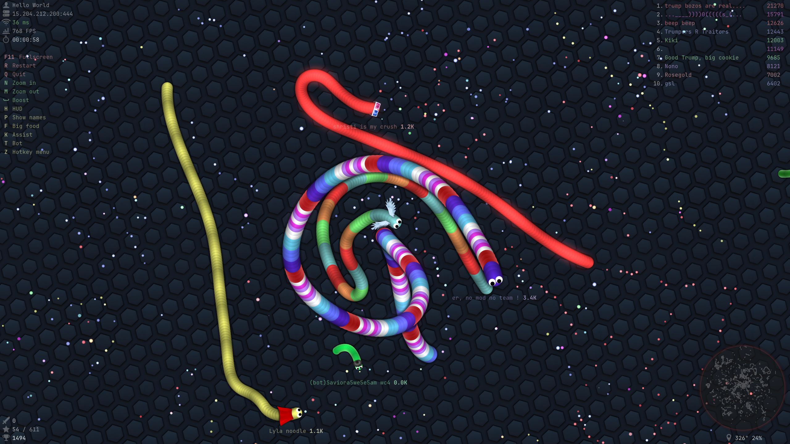

# Roshan.io
## Lightweight, FPS-locked desktop client for Slither.io

**© Roshan.io — Made by Roshan.io**

_Open-source credit: derived from [Vlither](https://github.com/for-loop9/vlither) by for-loop9, used under GPLv3 (this attribution is required by the license)._

### What's new in this build
- **FPS limiter** (Settings → General): 30 / **60 (default)** / 75 / 120 / 144 / 240 / Unlimited. Sleeps instead of busy-looping, so CPU/GPU stay cool.
- **Eco mode**: drops to 15 FPS automatically when the window is minimized or unfocused.
- **Lower RAM/VRAM**: texture atlas halved (7168x9216 -> 3584x4608, ~75% less memory), instance buffers cut 4x, frames-in-flight 3 -> 2.
- **New Roshan.io UI**: navy/violet theme, rounder widgets, branded title screen, credit footer, window title and in-game tag.

---


Roshan.io is a client for [Slither.io](https://slither.io) which can run outside the browser. It is written in C and uses Vulkan for rendering all the graphics, resulting in faster rendering. This implementation is based on [protocol version 19](./game1107241958.js), which was the latest version on web in May 2026. It has been tested on Windows 11, Debian 13, Ubuntu 24.04, and LMDE7 (AMD and Intel).

### Running Instructions
No dependencies are required to run the program. If your GPU supports at least Vulkan 1.0, there should be no issues. Download the latest build from this repository's **Releases** (or the **Actions** tab → latest run → Artifacts), unzip, and run `./run.sh`.

### Build Instructions
Prerequisites
- [Premake](https://premake.github.io) for generating makefiles
- [Vulkan SDK](https://www.lunarg.com/vulkan-sdk)
- [Python 3](https://www.python.org/downloads)
- GCC
- mingw-w64 (if targetting Windows)
- GDB if you plan to debug
- [CompileDB](https://github.com/nickdiego/compiledb) for intellisense
- Make
- X11 dependencies (only for Linux, see [here](https://www.glfw.org/docs/latest/compile.html))

For simplicity, _building_ is only documented for Linux.

Make sure the `VULKAN_SDK` environment variable is set (and acquire `vulkan-1.lib` and place it in `$VULKAN_SDK/lib` if targetting Windows).

```bash
git clone <your-roshan.io-repo-url>
cd <repo-folder>
python3 build.py 2 # compile shaders
python3 build.py 0 # debug build
./build/bin/linux_x86_64_debug/app
```
You may also work on the project with VS Code by opening the `.code-workspace` file. Make sure you have the required extensions installed:
- [C/C++ tools](https://marketplace.visualstudio.com/items?itemName=ms-vscode.cpptools)
- [clangd](https://marketplace.visualstudio.com/items?itemName=llvm-vs-code-extensions.vscode-clangd)
## Features

- Upscaled/sharper textures
- Supports all 66 skins and 32 accessories
- Custom skin
- Server selection
- Zoom
- Kill count
- Bot ([Saya's implemenation](https://github.com/saya-0x0efe/Slither.io-bot))

## 

## Credits
- **Roshan.io** — FPS limiter, eco mode, memory reductions, UI/theme and branding.
- Based on Vlither (GPLv3); bot by Saya.

## License
This project is licensed under the GNU General Public License v3.0 - see the [LICENSE](./LICENSE) file for details.

## Disclaimer & Copyright
All game assets, artwork, trademarks, and game content are the property of [Slither.io](https://slither.io).  
This project does **not** claim ownership over any game-related intellectual property. This application is provided for convenience and performance purposes only and is not affiliated with or endorsed by the original game developer.

Permission to open source this project was granted by the original developer. This grant of permission does not transfer any intellectual property rights, and all original copyrights and trademarks remain with their respective owners.
